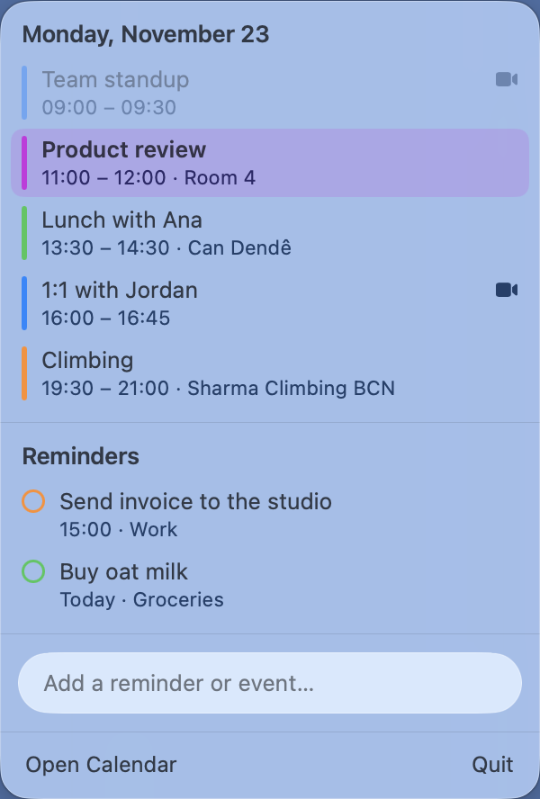
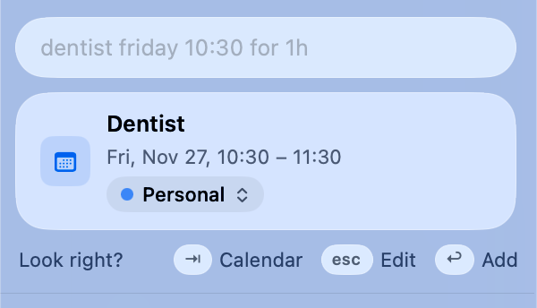

# DayBar

Today's calendar events and reminders in the macOS menu bar, with a quick-add field that understands plain English.

<p align="center">
  
  &nbsp;&nbsp;
  
</p>

More at **[marcdebatlle.com/bars](https://marcdebatlle.com/bars)**.

- **Hover** the menu bar item to see the rest of today. **Click** to pin it open.
- **⌥Space** opens it with the quick-add field focused. Type `call mom tomorrow 5pm` or `dentist friday 10:30 for 1h`, check the preview, and press Return.
- Quick-add parsing runs on-device with Apple Intelligence. Nothing leaves your Mac.

Requires **macOS 26** or later.

**Quick-add needs Apple Intelligence turned on** (System Settings → Apple Intelligence & Siri). The installer checks and tells you if it's off. Without it, DayBar still shows your day; only typing new events and reminders needs it. `DayBar --check-ai` prints `ready`, `off`, `downloading` or `unsupported`.

## Install

```bash
curl -fsSL https://marcdebatlle.com/bars/install.sh | bash
```

This downloads the latest release into `~/Applications` and opens it. Allow Calendar and Reminders access when macOS asks. DayBar adds itself to Login Items on first launch; remove it there if you'd rather start it yourself.

Uninstall:

```bash
curl -fsSL https://marcdebatlle.com/bars/install.sh | bash -s -- --uninstall
```

### Ask your coding agent to install it

Paste this into Claude Code, Codex, Cursor or any agent with shell access:

```text
Install DayBar, a macOS menu bar app, on this Mac. First read https://github.com/wyndollin/daybar/blob/main/install.sh so you know what it does, then run:

curl -fsSL https://marcdebatlle.com/bars/install.sh | bash

Check it's running with `pgrep -x DayBar`, then tell me to approve the Calendar and Reminders prompts. Run `~/Applications/DayBar.app/Contents/MacOS/DayBar --check-ai`: if it prints "off", tell me quick-add needs Apple Intelligence and to turn it on in System Settings → Apple Intelligence & Siri. If the script stops on the macOS version check, tell me DayBar needs macOS 26.
```

## Build from source

```bash
git clone https://github.com/wyndollin/daybar.git
cd daybar
scripts/build-app.sh ~/Applications
open ~/Applications/DayBar.app
```

Needs Xcode 26 (Swift 6.2). The app is ad-hoc signed.

### Screenshots

`DayBar --demo` fills the panel with sample events and opens it; `--demo-confirm` also shows the quick-add confirm card. Demo mode never reads or writes your calendars. Add `--backdrop 4A6FA5` to put a plain colour behind the panel before you take the screenshot. `--demo-type "dentist friday 10:30 for 1h"` types into quick-add, waits on the confirm card and adds it, for recordings.

`DayBar --parse "lunch with sam thu 1pm"` prints what quick-add would make of a phrase and exits.

## License

MIT
